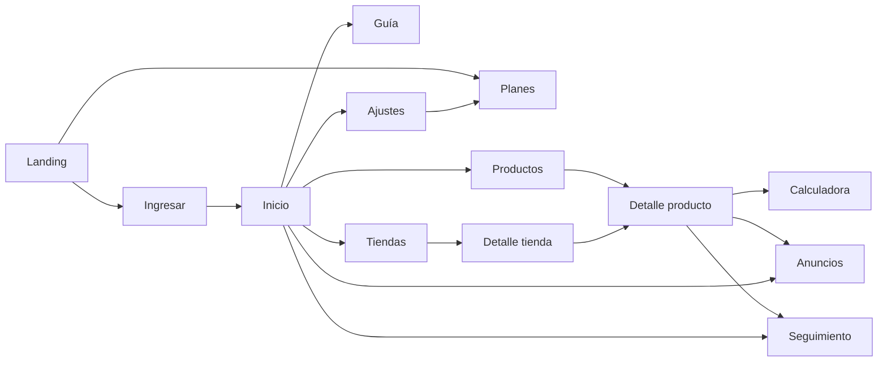

# Flujos

## F1. Alta e inicio de sesión
1. P00 → «Empezar gratis» → P01.
2. Registro con email o Google → elige país principal → P02.
3. Rama error: credenciales inválidas → mensaje en P01.

## F2. Primera experiencia (mejora de Veta)
1. P02 muestra la ruta guiada «Tu primer producto ganador» (5 pasos).
2. Cada paso lleva a la pantalla que toca (P03 → P04 → P09 → P05 → P08) y se marca solo al completarse.

## F3. Flujo núcleo: encontrar y validar un producto
1. P03: filtra por país + categoría + «ventas 7 días ≥ 10» + saturación baja.
2. Ordena por puntuación Veta → abre P04.
3. P04: revisa la tendencia, la regularidad de las ventas (días con venta) y el stock.
4. P04: la calculadora integrada da la utilidad por pedido entregado con devoluciones incluidas; si no da, se descarta.
5. P04: compara proveedores del mismo producto y elige el de mejor precio y stock.
6. P04: ve anuncios activos (P05 filtrado) para sacar ángulos.
7. P04: «Seguir» → P08 con alertas.
- Rama: producto agotado → P04 avisa y propone el proveedor alternativo.
- Rama: usuario sin plan → límite de búsquedas diarias y aviso hacia P11.

## F4. Pago o suscripción
1. P11 → elige plan → Stripe Checkout → vuelve a P02 con el plan activo.
2. Gestionar o cancelar → portal del cliente de Stripe. Sin permanencia.

## F5. Ajustes y borrado de cuenta
1. P12 → cambiar país, moneda, email.
2. «Borrar cuenta» → confirmación escribiendo BORRAR → borrado de datos y cancelación del plan.

## Mapa de navegación

